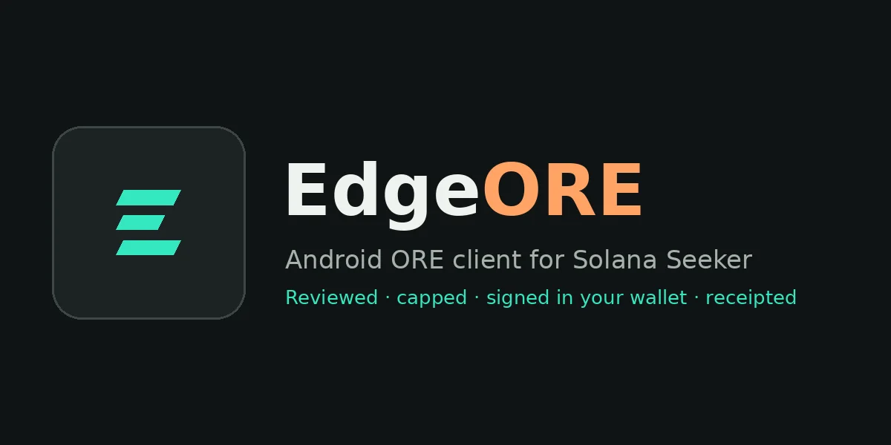
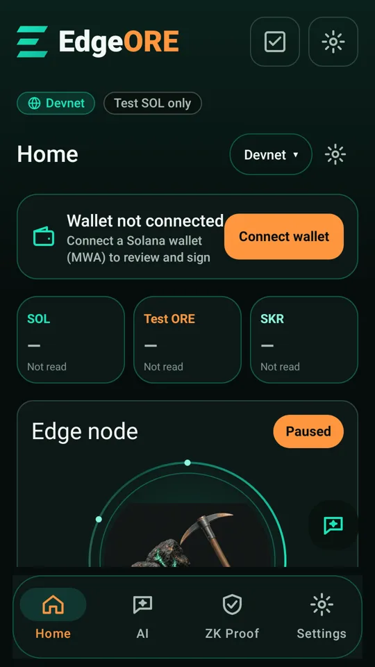
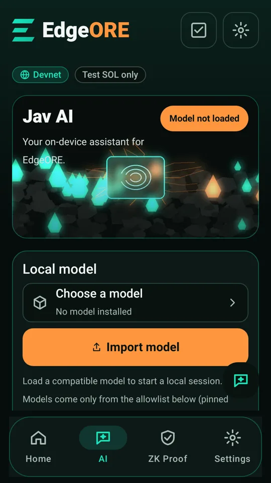
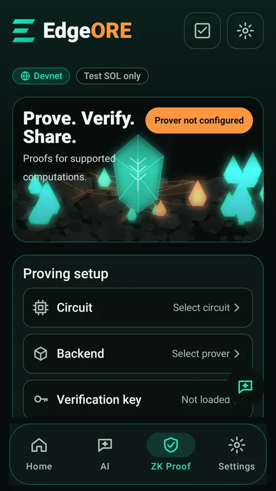
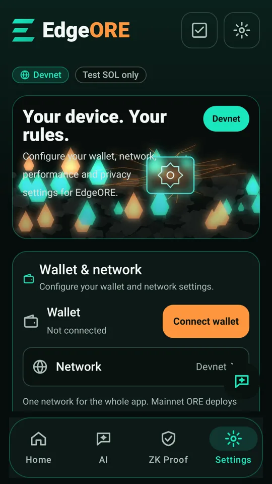
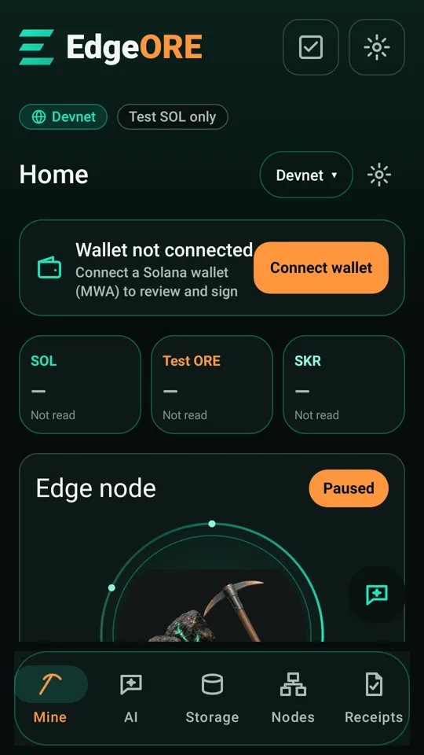
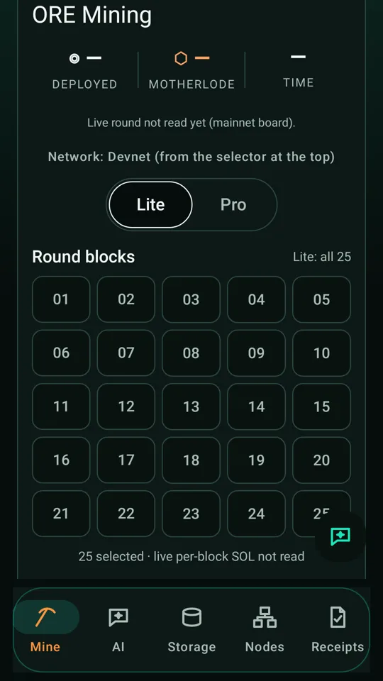
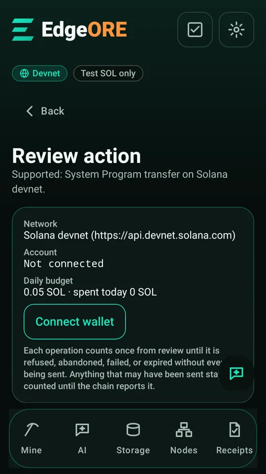
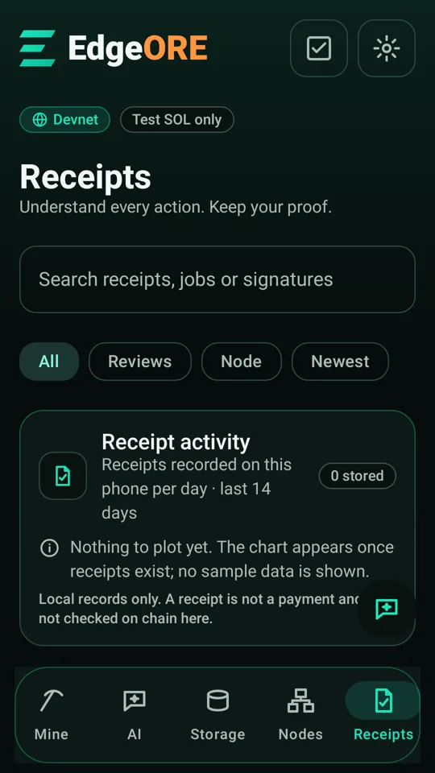

# EdgeORE

<!-- commit-stamp:begin -->
Canonical source commit: `e7e7864a0cf9466654f37ba14ea576d84abfc816` (stamped by `scripts/commit-stamp.sh`; the same value is in `evidence/COMMIT-STAMP.json` and the APK as `BuildConfig.SOURCE_STAMP`).
<!-- commit-stamp:end -->



**An Android ORE v3 client for Solana Mobile. Every deploy is reviewed as exact bytes, capped, signed in your own wallet, submitted once, and receipted.**

Version `0.1.0-clockin` (versionCode 12) · package `com.edgeore.app` · Kotlin / Jetpack Compose · Mobile Wallet Adapter · by **[CodesbyFebin](https://github.com/CodesbyFebin)** · Website: <https://codesbyfebin.github.io/EdgeORE/>

## Screenshots (current build)

| Home | AI | ZK Proof | Settings |
|---|---|---|---|
|  |  |  |  |

*Current build (Home / AI / ZK Proof / Settings). JVM (Robolectric) renders in the fresh-install state, not phone captures; balances read "Not read" because no wallet is connected.*

### Earlier build (5-tab layout)

| Home | ORE card | Review | Receipts |
|---|---|---|---|
|  |  |  |  |

*From the previous build (Mine / AI / Storage / Nodes / Receipts tabs), kept for reference. JVM (Robolectric) renders, not phone captures.*

## What This Is

EdgeORE is a non-custodial Android app for the ORE v3 program on Solana. It reads the live ORE board, builds a Deploy transaction for the squares you pick, shows you the exact message, has your Mobile Wallet Adapter wallet sign it, submits it once, and stores a receipt signed with an Android Keystore key.

## Why ORE, Why Mobile

- ORE rounds are short (about a minute), so a phone you already carry is a natural place to review and approve a deploy.
- Mobile Wallet Adapter keeps keys in the wallet app. EdgeORE never sees them.
- Android Keystore gives each install a hardware-backed (where available) key for signing local receipts.

## What's Built

**Screens:** Home · AI · ZK Proof · Settings (Settings hosts Receipts, Storage and Nodes).

| Feature | What it does |
|---|---|
| Network selector | One selector at the top of Home drives the wallet, balances and the ORE card. Devnet is the default. |
| Balances | SOL, ORE and SKR read over public RPC. Unread values show "Not read". |
| Live ORE v3 board | Reads the Board and Round accounts and shows a 5×5 grid with per-square SOL. |
| Mainnet opt-in | Mainnet deploys need Mainnet selected and the real-SOL risk box ticked. |
| 0.01 SOL cap | Each mainnet deploy is capped at 0.01 SOL across the selected squares, refused before any wallet request. Rent and network fees are extra. Rounds is fixed at 1. |
| Exact-message review | Decodes the exact bytes: program, round, squares, per-square amount, total, fee, blockhash and message SHA-256. |
| MWA signing | Signed in your wallet. Returned bytes must match the review, or the result is refused. |
| Single submit | Submit is a separate tap; the attempt is recorded first. A timeout stays "outcome unknown". No automatic retry or resend. |
| Signed receipts | Each outcome becomes a receipt signed with an Android Keystore key (labelled as a weaker software fallback if Keystore is unavailable). |
| Theme | Dark / Light / System, saved on the phone. |
| QR entry | "Scan QR" on the transfer review screen; frames are decoded on the phone and not saved. |
| Reminders | Opt-in local notifications (WorkManager). No balances or addresses in them. |
| Daily check-in | Streak and points stored on the phone only; no monetary value. |

| Optional, needs your own setup | Status in the app |
|---|---|
| AI | No model is bundled. Shows "Model not loaded" until you connect a host you own or download an allowlisted LiteRT-LM model (pinned Hugging Face commit + SHA-256) after consent. CPU only. The AI never signs. |
| ZK Proof | "Prover not configured": no circuit, backend or verification key is set up. No proofs are generated. |
| Node agent / storage gateway | Shown as a *Set up* step until you pair hardware you own. |

## ORE Integration

**Reads:** ORE v3 Board and Round accounts, your ORE balance, live per-square totals.
**Writes (only when you sign):** the ORE v3 `Deploy` instruction, checked against [regolith-labs/ore](https://github.com/regolith-labs/ore) at `48c203bd`.

Tested against the live mainnet ORE v3 program in a local fork (LiteSVM, `tools/ore-fork-sim`), rounds 437646 and 437756.

**Does NOT do:** checkpoint or claim of rewards, automatic or repeated deploys, multi-round deploys, mining on the phone CPU, any reward estimate.

## Architecture

```
 Home / AI / ZK Proof / Settings  (Compose)
              │
        EdgeOreViewModel
   ┌──────────┼──────────────┬───────────────┐
 ore/       solana/        wallet/         receipts/
 board      RPC, message   MWA client      Keystore-signed
 decode     build, review  (keys stay      operation ledger
            single submit   in wallet)
              │
   public Solana RPC (devnet / testnet / mainnet-beta)

 ondevice-llm/  Java-only LiteRT-LM bridge (optional, model downloaded after consent)
 tools/receipt-checker/  JVM checker reusing the app's Kotlin verifier
```

## Security Model

- Non-custodial: EdgeORE cannot sign; only your MWA wallet can.
- Exact-message review → MWA sign → returned-bytes check → one separate submit → signed receipt.
- An unknown outcome is re-read from chain after restart, never resent.
- A damaged operation store disables transfers rather than being treated as empty.
- `FLAG_SECURE` on wallet-adjacent screens in release builds.
- No analytics, ads or crash-reporting SDKs. No EdgeORE backend.
- Report vulnerabilities privately: [SECURITY.md](SECURITY.md).

## Receipt Chain

Each reviewed action is written to the on-device operation ledger and signed with the install's Android Keystore key. The JVM receipt checker compiles the app's own Kotlin verifier and verifies the integrity of signed receipt contents.

```bash
bash gradlew -p tools/receipt-checker test installDist
bash scripts/verify-receipt.sh /absolute/path/original.json
# Optional: pin a DER SubjectPublicKeyInfo obtained through a trusted channel
bash scripts/verify-receipt.sh original.json --trusted-key device-spki.der
```

Exit codes: **0** accepted, **1** rejected, **2** invocation/read/build error. Details: [tools/receipt-checker/README.md](tools/receipt-checker/README.md).

Boundary: the device signature shows this install wrote the record; the wallet's Ed25519 signature is checked separately. Offline verification does not confirm an on-chain outcome, and an included key alone does not establish trusted provenance.

## Roadmap

These are plans, not progress. No timelines, no partnerships.

- ORE checkpoint and claim through the same review → sign → submit → receipt path.
- More real-device testing across wallets and Seeker.
- Exploratory: an ORE SDK layer for other Android apps; a Reserve viewer; TEE / ZK attestation of receipts.

## Hard Rules

- You approve every transaction. No auto-spend, no resend.
- Mainnet deploys are capped at 0.01 SOL and need the risk tick.
- No reward, income or earnings claims. Deployed SOL may be lost entirely.
- The AI advisor never signs or deploys.
- Pinned toolchain (Kotlin 2.0.21, AGP 8.7.3, MWA clientlib-ktx 2.0.3); no bumps without re-testing.

## Build & Run

Requirements: JDK 17, Android SDK platform 35, the repository's Gradle 8.9 wrapper. minSdk 26, target/compile SDK 35.

```bash
git clone https://github.com/CodesbyFebin/EdgeORE.git && cd EdgeORE
./gradlew :app:assembleDebug
./gradlew :app:testDebugUnitTest :app:lintDebug
adb install -r app/build/outputs/apk/debug/app-debug.apk
```

Test results at source commit `2ed7c06` (the README and images changed after; no code changed), each suite counted on its own (never summed):

| Suite | Result |
|---|---|
| Android unit tests (`:app:testDebugUnitTest`) | 400 run · 391 passed · 9 skipped · 0 failed |
| Receipt checker (JVM, `tools/receipt-checker`) | 17 run · 17 passed |
| Offline kit (Python, `tools/edgeore-kit`) | 22 run · 22 passed |

Lint (`:app:lintDebug`, detekt, ktlint) passes against committed baselines in `config/`; existing findings are baselined, not fixed.

Release APKs are signed with certificate SHA-256 `c2279fb0357bd3b78e577d57b93d5d9af273fb03191264811b6e3696165e62d2`. Check with `apksigner verify --print-certs`. A debug-signed install cannot be upgraded by the release build (or vice versa).

## Project Structure

| Path | Contents |
|---|---|
| `app/` | Android app (Kotlin/Compose) |
| `ondevice-llm/` | Java-only LiteRT-LM bridge module |
| `tools/receipt-checker/` | JVM receipt checker |
| `tools/ore-fork-sim/`, `tools/ore-fixtures/` | Mainnet-fork simulation and fixtures |
| `tools/edgeore-kit/` | Offline Python kit |
| `services/storage-gateway/` | Optional self-hosted storage gateway |
| `onchain/` | Devnet receipt-settlement program |
| `docs/` | Docs, legal, design, evidence write-ups |
| `evidence/` | Recorded build and test evidence |

## Hackathon Context

Built solo by CodesbyFebin for the Solana Mobile CLOCK IN hackathon. Hackathon package: [docs/pitch/HACKATHON.md](docs/pitch/HACKATHON.md) · [docs/submission/](docs/submission/).

## What This Is Not

- Not a miner: nothing mines on the phone.
- Not a source of income: no rewards are promised or estimated.
- Not production-ready: a hackathon build, provided as is.
- Not affiliated with Regolith Labs or Solana Mobile.
- Not a wallet: keys stay in your MWA wallet.

## License

[Apache License 2.0](LICENSE). Dependencies keep their own licenses.

## Credits

- [ORE](https://github.com/regolith-labs/ore) by Regolith Labs (v3 program and instruction layout).
- [Solana Mobile Wallet Adapter](https://github.com/solana-mobile/mobile-wallet-adapter).
- [Google AI Edge Gallery](https://github.com/google-ai-edge/gallery) and LiteRT-LM (Apache-2.0), ZXing core (Apache-2.0). Full attribution in [NOTICE](NOTICE).

Terms: [docs/legal/TERMS.md](docs/legal/TERMS.md) · Privacy: [docs/legal/PRIVACY.md](docs/legal/PRIVACY.md)
